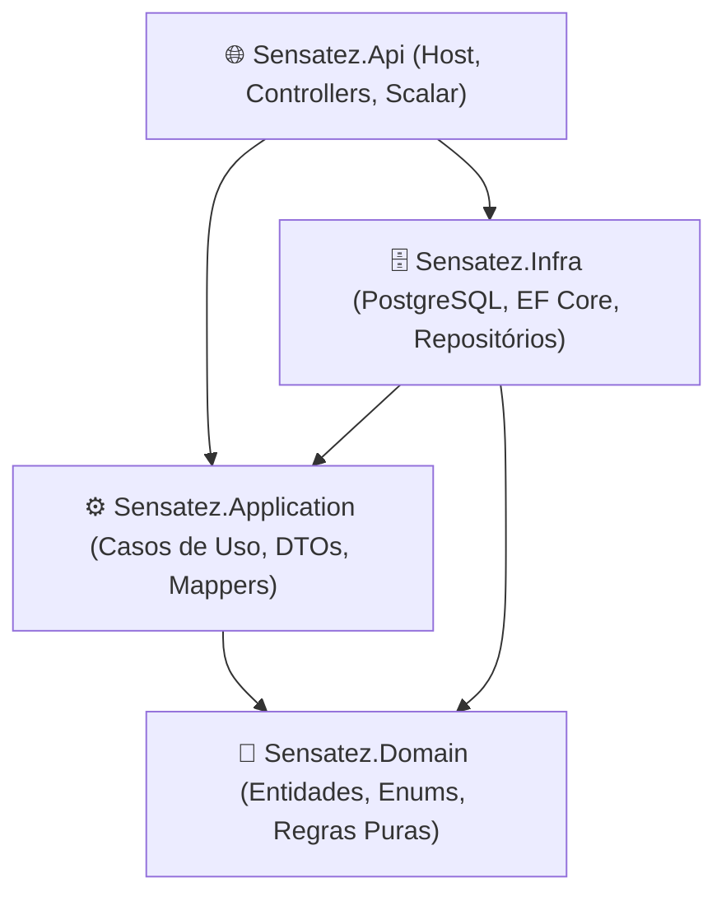

# 🧠 Sensatez — .NET 10 Clean Architecture

Projeto estruturado sob os princípios estritos da **Clean Architecture** utilizando **.NET 10 (C# 13)**, focado em separação clara de responsabilidades, alta performance de mapeamento sem reflexão, validação *Fail-Fast* e padronização de erros HTTP (RFC 7807).

---

## 🏗️ Arquitetura da Solução

A solução utiliza o formato moderno **`.slnx`** e divide o código em **4 projetos estritos** dentro da pasta `src/`, seguindo a Regra de Dependência da **Clean Architecture**:



- **`Sensatez.Domain`**: O núcleo do negócio. Contém entidades POCO e Enums puros, com zero dependências externas.
- **`Sensatez.Application`**: Orquestração de casos de uso, DTOs imutáveis (`positional records`), validadores com `FluentValidation`, exceções de domínio (`NotFoundException`, `BusinessRuleException`), interfaces de repositório/serviço e Mappers estáticos via *Extension Methods*.
- **`Sensatez.Infra`**: Camada de persistência e infraestrutura. Contém o `SensatezDbContext`, configurações via Fluent API (`IEntityTypeConfiguration<T>`), histórico de Migrations e implementações dos repositórios com EF Core.
- **`Sensatez.Api`**: Camada de apresentação HTTP. Configura injeção de dependência, aplicação automática de migrations no startup, middleware global de tratamento de exceções (`ExceptionHandlingMiddleware` - RFC 7807 `ProblemDetails`) e documentação interativa via **Scalar**.

---

## 🚀 Tecnologias & Ferramentas

- **Linguagem & Runtime:** C# 13 / .NET 10
- **Banco de Dados:** PostgreSQL 16 (via Docker)
- **ORM:** Entity Framework Core 10 (`Npgsql.EntityFrameworkCore.PostgreSQL`)
- **Validação:** FluentValidation 12
- **Segurança / Hashing:** BCrypt.Net-Next
- **Documentação de API:** Scalar API Reference (`Scalar.AspNetCore` + `Microsoft.AspNetCore.OpenApi`)
- **Containerização:** Docker & Docker Compose

---

## 🛠️ Como Executar a Aplicação

### 1. Pré-requisitos

- [.NET 10 SDK](https://dotnet.microsoft.com/) instalado.
- [Docker Desktop](https://www.docker.com/) rodando.

### 2. Subir o Banco de Dados (PostgreSQL + pgAdmin)

Na raiz do projeto, execute:

```bash
docker compose up -d
```

Isso iniciará:

- **PostgreSQL 16** na porta `5432` (`user: postgres`, `password: postgres`, `database: sensatez_db`).
- **pgAdmin 4** na porta `5050` (`email: admin@admin.com`, `password: admin`).

### 3. Rodar a API

Execute a API pelo terminal:

```bash
dotnet run --project src/Sensatez.Api/Sensatez.Api.csproj
```

> **Nota:** A aplicação está configurada para aplicar as **migrations automaticamente no startup** (`dbContext.Database.Migrate()`).

### 4. Acessar a Documentação Interativa

Com a API rodando em ambiente de desenvolvimento, acesse:
👉 **`http://localhost:5114/scalar/v1`** (ou **`https://localhost:7122/scalar/v1`**).
